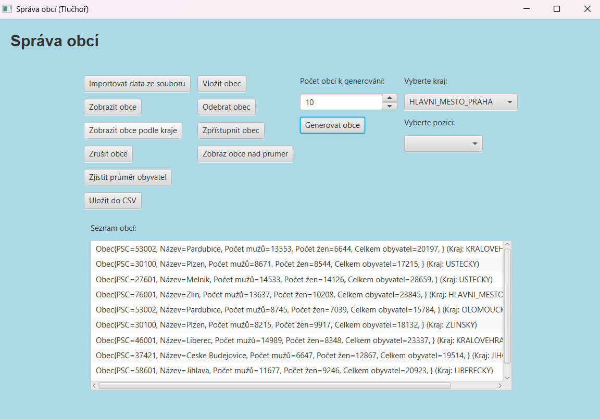

# 🏙️ Datové struktury – Semestrální práce A

**Akademický rok:** 2024/2025  
**Autor:** Aleš Tlučhoř  
**Univerzita:** Univerzita Pardubice  
**Fakulta:** Fakulta elektrotechniky a informatiky (FEI)  
**Předmět:** Datové struktury

---

## 📖 O projektu

Tento projekt vznikl v rámci předmětu **Datové struktury** v akademickém roce 2024/2025 na Univerzitě Pardubice, Fakultě elektrotechniky a informatiky (FEI).

Cílem semestrální práce bylo navrhnout a implementovat abstraktní datovou strukturu **obousměrně cyklicky zřetězeného lineárního seznamu** a následně ji využít při vytváření aplikace pro správu obcí České republiky.

Aplikace umožňuje evidenci obcí rozdělených podle jednotlivých krajů, manipulaci s jejich pořadím, vyhledávání a vyhodnocování statistických údajů o počtu obyvatel.

## 🖥️ Ukázka aplikace

Hlavní okno aplikace **Správa obcí** umožňuje práci s evidencí obcí a jednotlivými kraji České republiky.



## 🛠️ Použité technologie

- **Java** – hlavní programovací jazyk
- **JavaFX** – grafické uživatelské rozhraní
- **Maven** – správa projektu a závislostí
- **NetBeans** – vývojové prostředí

## 🧩 Implementované datové struktury

### Obousměrně cyklicky zřetězený lineární seznam

Hlavní částí projektu je implementace abstraktní datové struktury v modulu `ABSTRDOUBLELIST`.

Seznam je realizován v dynamické paměti a umožňuje pohyb oběma směry mezi jednotlivými prvky. Jeho struktura je cyklická, takže poslední prvek odkazuje zpět na první a první prvek na poslední.

**Základní operace:**
- Vkládání prvků na začátek a konec seznamu.
- Vkládání následníka a předchůdce aktuálního prvku.
- Zpřístupnění prvního, posledního a aktuálního prvku.
- Zpřístupnění předchůdce a následníka.
- Odebírání prvků z jednotlivých pozic.
- Zrušení celého seznamu.
- Kontrola prázdnosti seznamu.
- Iterace pomocí rozhraní `Iterable`.

### Pole seznamů

Jednotlivé kraje České republiky jsou reprezentovány pomocí pole, jehož prvky odkazují na samostatné obousměrně cyklické seznamy obcí.

Toto řešení umožňuje oddělenou správu obcí v jednotlivých krajích.

## 🏘️ Modul Obyvatele

Modul `Obyvatele` zajišťuje správu obcí a jejich přiřazení k jednotlivým krajům.

**Hlavní funkcionality:**
- Import dat ze souboru `kraje.csv`.
- Vkládání obcí na požadované pozice.
- Zpřístupnění obcí podle zvolené pozice.
- Odebírání obcí ze seznamu.
- Výpočet průměrného počtu obyvatel v kraji.
- Výpis obcí v jednotlivých krajích.
- Vyhledání obcí s nadprůměrným počtem obyvatel.
- Mazání obcí v konkrétním kraji nebo ve všech krajích.

### 📊 Evidence obcí

Každá obec obsahuje následující údaje:
- PSČ
- Název obce
- Počet mužů
- Počet žen
- Celkový počet obyvatel

## 🎨 Uživatelské rozhraní

Pro ovládání aplikace byl vytvořen formulářový modul `ProgObyvatele`.

Uživatelské rozhraní umožňuje:
- Import dat ze souboru.
- Vkládání a odebírání obcí.
- Zobrazení všech evidovaných obcí.
- Zobrazení obcí podle vybraného kraje.
- Výpočet průměrného počtu obyvatel.
- Zobrazení obcí s nadprůměrným počtem obyvatel.
- Generování nových obcí.
- Ukládání a načítání dat ze souborů.

## 📂 Struktura projektu

```text
BDATS_SemA/
│
├── src/
│   └── main/
│       └── java/
│           └── ...
│
├── images/
│   └── hlavni-okno.png
│
├── kraje.csv
├── pom.xml
├── nbactions.xml
├── nb-configuration.xml
├── .gitignore
├── README.md
└── Semestralni prace A2.pdf
```

## 📄 Zadání semestrální práce

Projekt vychází z původního zadání Semestrální práce A z předmětu Datové struktury pro akademický rok 2024/2025.

📎 **[Zobrazit kompletní zadání semestrální práce (PDF)](Semestralni%20prace%20A2.pdf)**

## 👨‍🎓 Autor

**Aleš Tlučhoř**

Univerzita Pardubice  
Fakulta elektrotechniky a informatiky (FEI)  
Předmět: Datové struktury  
Akademický rok: 2024/2025

---

⭐ *Univerzitní projekt zaměřený na návrh a implementaci abstraktních datových struktur v jazyce Java.*